# Sprawozdanie — Symulacja pożaru Biebrzańskiego Parku Narodowego (kwiecień 2020) w pakiecie IGA-ADS

**Pliki źródłowe:** `examples/fire/fire.cpp`, `examples/fire/fire.hpp` (kopie w katalogu [`kod/`](kod/))  
**Autorzy:** Hubert Tułacz, Piotr Śmiałek, Tomasz Furgała

---

## 1. Cel

Celem projektu jest symulacja nieliniowego rozprzestrzeniania się pożaru roślinności (ang. *wildfire*) w domenie dwuwymiarowej przy wykorzystaniu środowiska **IGA-ADS** (*Isogeometric Analysis with Alternating Direction Solver*) oraz odwzorowanie w niej przebiegu rzeczywistego pożaru wielkopowierzchniowego.

Jako pożar referencyjny wybrano **pożar Biebrzańskiego Parku Narodowego z 19–26 kwietnia 2020 r.**, największy pożar w historii parku (5526 ha). Kod `wildfire.*` z polecenia odpowiada przykładowi `examples/fire` (pliki `fire.cpp`, `fire.hpp`) w repozytorium iga-ads (gałąź `develop`) — jest to ten sam kod, który omawia prezentacja. Zgodnie z poleceniem w kodzie `fire.*` zmodyfikowano:

- wektor wiatru w `compute_rhs` — funkcje $b_x(x,y,t)$, $b_y(x,y,t)$ zależne od położenia i czasu (rozdział 5.4 "Funkcja wiatru"),
- stan początkowy temperatury `init_state` (rozdział 5.3 "Stan początkowy"),
- mapę materiałów palnych `fuel_init` (rozdział 5.2 "Mapa paliwa").

Model odwzorowuje zjawiska transportu ciepła (przewodnictwo, promieniowanie, konwekcję atmosferyczną, adwekcję wiatrem) sprzężone z kinetyką chemiczną spalania biomasy oraz dynamicznym wypalaniem paliwa roślinnego.

---

## 2. Model matematyczny z prezentacji i artykułu źródłowego

Model fizyczny opiera się na pracach:

> Paolo Grasso, Mauro S. Innocente, *Physics-based model of wildfire propagation towards faster-than-real-time simulations*, Computers & Mathematics with Applications 80(5) (2020) 790–808.  
> Marcin Łoś, Maciej Paszyński, *Wildfire IGA-ADS simulations*, Katedra Informatyki AGH, 2024.

Model składa się z dwóch sprzężonych równań różniczkowych cząstkowych:

1. Równania bilansu energii (rozkład temperatury $T$),
2. Równania kinetyki chemicznej zużycia paliwa roślinnego (ułamek masowy paliwa $X_{fuel}$).

### 2.1. Równanie bilansu energii cieplnej

Rozkład temperatury $T(x,y,t)$ [K] opisany jest równaniem bilansu energii:

$$
\rho \frac{\partial}{\partial t} (c_p T) = R_C + Q_W - \nabla \cdot (q_C + q_D + q_r) + Q_{conv} + Q_{rz}
$$

gdzie:

- $\rho$ — gęstość mieszaniny gazów [$\mathrm{kg/m^3}$],
- $c_p$ — pojemność cieplna (ciepło właściwe przy stałym ciśnieniu) [$\mathrm{J/(kg\cdot K)}$],
- $R_C$ — źródło energii chemicznej z procesu spalania,
- $Q_W$ — człon wymuszenia/adwekcji związany z prędkością wiatru atmosferycznego,
- $q_C$ — przewodnościowy strumień ciepła (prawo Fouriera),
- $q_D$ — międzydyfuzyjny strumień entalpii (w uproszczonym modelu pomijany: $q_D = 0$),
- $q_r$ — radiacyjny strumień ciepła w płaszczyźnie poziomej (promieniowanie w ośrodku roślinnym),
- $Q_{conv}$ — konwekcyjna wymiana ciepła z otaczającą atmosferą,
- $Q_{rz}$ — pionowe straty ciepła przez promieniowanie do atmosfery.

### 2.2. Poszczególne składniki modelu energii

1. **Źródło energii spalania ($R_C$):**
   $$
   R_C = \rho \, c_h \, h_c \, \frac{M}{M_1} \, r
   $$
   gdzie:
   - $h_c$ — entalpia reakcji spalania [$\mathrm{J/kg}$],
   - $c_h$ — współczynnik entalpii,
   - $M$ — masa molowa mieszaniny gazowej,
   - $M_1$ — masa molowa paliwa,
   - $r$ — szybkość reakcji chemicznej opisana zmodyfikowanym prawem Arrheniusa:
     $$
     r = \delta \cdot A_r \cdot T \cdot \exp\left(-\frac{T_a}{T}\right)
     $$
     gdzie $\delta$ jest nieliniową funkcją aktywacji zapłonu zależną od temperatury i dostępności paliwa:
     $$
     \delta = \begin{cases} 1 & \text{gdy } T > T_{ig} \quad \text{oraz} \quad \text{fuel} > 0.2 \\ 0 & \text{w przeciwnym razie} \end{cases}
     $$
     Parametry: $T_{ig} = 800\,\mathrm{K}$ (temperatura zapłonu), $T_a = 300\,\mathrm{K}$ (temperatura aktywacji), $A_r = 5.7\times 10^{-5}$. W kodzie (tak jak w prezentacji) entalpia ma wartość $h_c = -70$ — dla reakcji egzotermicznej jest ujemna — dlatego człon źródłowy ma postać $R_C = -10^4 \rho\, c_h h_c \frac{M}{M_1} r > 0$ (minus nadaje mu znak źródła ciepła, a $10^4$ to współczynnik skalujący).

2. **Oddziaływanie wiatru atmosferycznego ($Q_W$):**
   $$
   Q_W = - \rho \, c_W \, \mathbf{b} \cdot \nabla (c_p T)
   $$
   gdzie $\mathbf{b} = (b_x, b_y)$ to wektor prędkości wiatru atmosferycznego, a $c_W$ to współczynnik redukcji wiatru. W naszej symulacji $\mathbf{b} = \mathbf{b}(x, y, t)$ zależy od położenia i czasu (rozdział 5.4 "Funkcja wiatru").

3. **Przewodnictwo cieplne ($q_C$):**
   $$
   q_C = - \kappa \nabla T
   $$
   gdzie $\kappa$ to współczynnik przewodności cieplnej roślinności i powietrza [$\mathrm{W/(m\cdot K)}$].

4. **Strumień promieniowania cieplnego w poziomie ($q_r$):**
   Zgodnie z modelem gazu optycznie gęstego (przybliżenie dyfuzyjne Rosselanda ze stałą Stefana-Boltzmanna $\sigma$):
   $$
   q_r = - 4 \sigma \epsilon \delta_x T^3 \nabla T
   $$
   gdzie $\sigma = 5.67\times 10^{-8}\,\mathrm{W/(m^2 K^4)}$, $\epsilon = 0.05$ to emisyjność, a $\delta_x$ to pozioma droga swobodna fotonów / długość absorpcji ($\delta_x = 3.5\times 10^{-2} / \epsilon$).

5. **Konwekcyjne straty ciepła do atmosfery ($Q_{conv}$):**
   $$
   Q_{conv} = \chi \, (T_{amb} - T)
   $$
   gdzie $\chi$ to współczynnik przejmowania ciepła drogą konwekcji, a $T_{amb} = 300\,\mathrm{K}$ to temperatura otoczenia.

6. **Pionowe straty przez promieniowanie ku niebu ($Q_{rz}$):**
   $$
   Q_{rz} = \sigma \epsilon \delta_z^{-1} (T_{amb}^4 - T^4)
   $$
   gdzie $\delta_z = 1.5\,\epsilon$ reprezentuje pionowy współczynnik emisji.

### 2.3. Równanie ubytku paliwa (biomasy)

Szybkość ubytku paliwa w wyniku spalania opisana jest zależnością:

$$
\frac{\partial (\text{fuel})}{\partial t} = - \delta \cdot C_{fuel} \cdot r \cdot \text{fuel}
$$

gdzie stała proporcjonalności wynosi $C_{fuel} = 300$. Gdy paliwo zostanie zużyte poniżej progu $0.2$, funkcja $\delta$ przyjmuje wartość 0, co zatrzymuje proces spalania w danym punkcie przestrzeni i uniemożliwia dalsze wydzielanie ciepła. Wynika stąd ważna dla mapy paliwa własność modelu: punkt o paliwie $\le 0.2$ w ogóle się nie pali, a punkt o paliwie $F_0 > 0.2$ pali się przez czas proporcjonalny do $\ln(F_0 / 0.2)$ — mało paliwa oznacza krótkie spalanie i mało oddanego ciepła.

---

## 3. Przełożenie wzoru na kod (IGA-ADS)

### 3.1. Sformułowanie słabe (wariacyjne) FEM

W metodzie elementów skończonych równanie energii mnożone jest przez funkcję testową $v$ należącą do przestrzeni funkcji B-spline i całkowane po domenie $\Omega$.

Dla członów dywergencyjnych $-\nabla \cdot (q_C + q_r)$, całkowanie przez części (twierdzenie Gaussa-Ostrogradskiego) przenosi pochodną przestrzenną na funkcję testową:

$$
-\int_{\Omega} \nabla \cdot (q_C + q_r) \, v \, d\Omega = \int_{\Omega} (q_C + q_r) \cdot \nabla v \, d\Omega - \int_{\partial\Omega} ((q_C + q_r)\cdot \mathbf{n}) v \, ds
$$

W dyskretyzacji czasowej ze schematem jawnym (explicit time stepping), przy założeniu zerowych strumieni na brzegu domeny, sformułowanie słabe w elemencie przyjmuje postać:

$$
(U, v) = (U^{t-1}, v) + \Delta t \cdot \frac{1}{\rho c_p} \int_{\Omega} \Big[ (R_C + Q_W + Q_{conv} + Q_{rz})\, v + (q_C + q_r) \cdot \nabla v \Big] \, d\Omega
$$

(W symulacji temperatura na brzegu domeny jest dodatkowo ustawiana na $T_0$ po każdym kroku — rozdział 5.6 "Uwagi numeryczne".)

### 3.2. Zestawienie wzorów fizycznych z kodem w `fire.hpp`

| Składnik fizyczny | Wzór analityczny | Odpowiednik w `compute_rhs` (`fire.hpp`) |
|---|---|---|
| Pojemność i gęstość | $\frac{1}{\rho c_p}$ | `double inv = 1.0 / (rho * cp);` |
| Aktywacja zapłonu $\delta$ | $\delta = \mathbb{I}(T > 800 \land \text{fuel} > 0.2)$ | `double delta = u.val > Tig && fuel.val > 0.2 ? 1.0 : 0.0;` |
| Szybkość reakcji $r$ | $\delta A_r T \exp(-T_a/T)$ | `double r = delta * Ar * T * std::exp(-Ta / T);` |
| Źródło spalania $R_C$ | $-10^4 \rho c_h h_c \frac{M}{M_1} r$ ($h_c = -70$) | `double Rc = - 1e4 * rho * ch * hc * M / M1 * r;` |
| Człon wiatru $Q_W$ | $-\rho c_W \mathbf{b}(x,y,t)\cdot\nabla(c_p T)$ | `double Qw = - rho * cw * (wx * u.dx + wy * u.dy);`, gdzie `wx = bx(x, y, t)`, `wy = by(x, y, t)` |
| Przewodnictwo $q_C \cdot \nabla v$ | $-\kappa \nabla T \cdot \nabla v$ | `double qc = - kappa * grad_dot(u, v);` |
| Radiacja pozioma $q_r \cdot \nabla v$ | $-4\sigma\epsilon\delta_x T^3 \nabla T \cdot \nabla v$ | `double qr = -4 * sigma * eps * delta_x * std::pow(T, 3) * grad_dot(u, v);` |
| Konwekcja $Q_{conv}$ | $\chi (T_0 - T)$ | `double Qconv = xi * (T0 - u.val);` |
| Radiacja pionowa $Q_{rz}$ | $\sigma\epsilon\delta_z^{-1}(T_0^4 - T^4)$ | `double Qrz = sigma * eps / delta_z * (std::pow(T0, 4) - std::pow(T, 4));` |
| Całka równania energii | $\int_\Omega (\dots) d\Omega$ | `double val = (Rc + Qw + Qconv + Qrz) * v.val + qc + qd + qr;`<br>`U(aa[0], aa[1]) += (u.val * v.val + steps.dt * inv * val) * w * J;` |
| Ubytek paliwa | $\frac{\partial F}{\partial t} = -300 \delta r F$ | `double fval = - delta * 3e2 * r * fuel.val * v.val;`<br>`F(aa[0], aa[1]) += (fuel.val * v.val + steps.dt * fval) * w * J;` |

W członach nieliniowych ($r$, $q_r$, $Q_{rz}$) używana jest zmienna `T = std::max(u.val, 1.0)` zamiast `u.val` — jest to zabezpieczenie numeryczne opisane w rozdziale 5.6 "Uwagi numeryczne". Dla fizycznych temperatur ($T > 1$ K) są to dokładnie wzory modelu.

### 3.3. Kluczowy fragment implementacji `compute_rhs`

```cpp
void compute_rhs(double t) {
    auto& rhs = u;
    auto& rhs_fuel = fuel;

    zero(rhs);
    zero(rhs_fuel);
    executor.for_each(elements(), [&](index_type e) {
        auto U = element_rhs();
        auto F = element_rhs();

        double J = jacobian(e);
        for (auto q : quad_points()) {
            double w = weight(q);
            // Wiatr zalezny od polozenia i czasu
            auto p = point(e, q);
            double x = p[0];
            double y = p[1];
            double wx = bx(x, y, t);
            double wy = by(x, y, t);

            value_type u = eval_fun(u_prev, e, q);
            value_type fuel = eval_fun(fuel_prev, e, q);
            // Zabezpieczenie numeryczne - przy silnym wietrze oscylacje schematu jawnego
            // moga dac T < 0 K, a wtedy czlony ~T^3 i ~T^4 "uciekaja" do -inf (NaN).
            // W czlonach nieliniowych uzywamy wiec T = max(u, 1 K).
            double T = std::max(u.val, 1.0);

            for (auto a : dofs_on_element(e)) {
                auto aa = dof_global_to_local(e, a);
                value_type v = eval_basis(e, q, a);
                double inv = 1.0 / (rho * cp);

                double delta = u.val > Tig && fuel.val > 0.2 ? 1.0 : 0.0;
                double hc = -70; // enthalpy
                double r = delta * Ar * T * std::exp(-Ta / T);
                double Rc = - 1e4 * rho * ch * hc * M / M1 * r;
                double Qw = - rho * cw * (wx * u.dx + wy * u.dy);
                double qc = - kappa * grad_dot(u, v);
                double qd = 0.0; // omitted
                double qr = -4 * sigma * eps * delta_x * std::pow(T, 3) * grad_dot(u, v);
                double Qconv = xi * (T0 - u.val);
                double Qrz = sigma * eps / delta_z * (std::pow(T0, 4) - std::pow(T, 4));

                double val = (Rc + Qw + Qconv + Qrz) * v.val + qc + qd + qr;
                U(aa[0], aa[1]) += (u.val * v.val + steps.dt * inv * val) * w * J;

                double fval = - delta * 3e2 * r * fuel.val * v.val;
                F(aa[0], aa[1]) += (fuel.val * v.val + steps.dt * fval) * w * J;
            }
        }
        executor.synchronized([&] { update_global_rhs(rhs, U, e); });
        executor.synchronized([&] { update_global_rhs(rhs_fuel, F, e); });
    });
}
```

---

## 4. Wybrany pożar: Biebrzański Park Narodowy, 19–26 kwietnia 2020 r.

### 4.1. Opis pożaru

Biebrzański Park Narodowy (BbPN) to największy park narodowy w Polsce (592 km², województwo podlaskie), chroniący rozległe bagna i torfowiska doliny Biebrzy. Dolina dzieli się na trzy baseny; pożar objął znaczną część **Basenu Środkowego** — obniżenia o wymiarach ok. 20 × 40 km pomiędzy Sztabinem a Osowcem, z obniżonym poziomem wód gruntowych (XIX-wieczne kanały Augustowski, Woźnawiejski i Rudzki).

Najważniejsze fakty:

- **Początek:** ogień zauważono w Niedzielę Wielkanocną, **19 kwietnia 2020 r.** wieczorem, w Basenie Środkowym; do Państwowej Straży Pożarnej zgłoszono go 20.04 o 7:45 UTC (Copernicus EMS, aktywacja EMSR436).
- **Przyczyna:** nielegalne wypalanie traw (wg prokuratury i Ministra Środowiska), przy wyjątkowej suszy wiosną 2020 r. — wiosenne zalewy, które zwykle chronią łąki, nie wystąpiły.
- **Warunki:** susza i silny wiatr powodowały wielokrotne ponowne zapalanie się już ugaszonych miejsc (Forsal, 22.04). 22.04 silny wiatr wiał w stronę rzeki, a wieczorem osłabł (RMF24, 22.04).
- **Przebieg:** ogień szedł wzdłuż doliny Biebrzy w kierunku SW; 22.04 ściana ognia zbliżyła się do Goniądza i została zatrzymana ok. 300 m od zabudowań, a jednocześnie trwała walka z ogniem na północnej flance (Grzędy, Kapice), gdzie broniono cennych lasów Czerwonego Bagna, Grzęd i Brzezin Kapickich (RMF24; Ceranka i in. 2025).
- **Zasięg końcowy:** **5526 ha** (ok. 9,5% powierzchni parku): 4580 ha w parku i 946 ha w otulinie; w tym **1127 ha ekosystemów leśnych** i 4399 ha nieleśnych (trzcinowiska, turzycowiska, łąki). Pożar miał charakter powierzchniowy — nie zajął pokładów torfu.
- **Akcja gaśnicza:** ok. 1500 strażaków, ponad 300 ratowników i żołnierzy WOT, 6 samolotów i 2 śmigłowce (ok. 1000 zrzutów wody). Obszar wypalony nie powiększył się po 23.04; akcję zakończono **26.04** po południu (Notes from Poland, 27.04).

### 4.2. Przebieg w czasie — mapa zmian zasięgu

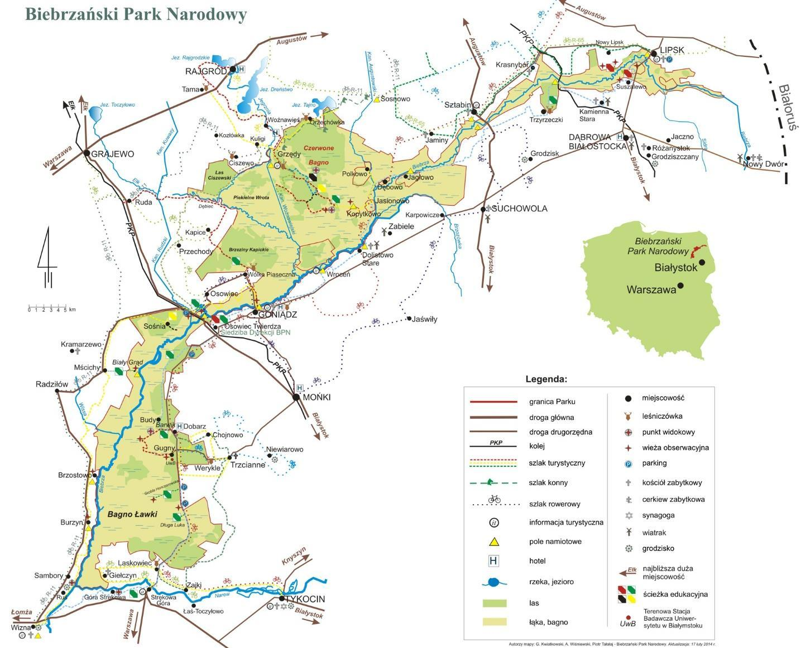

*Rys. 1. Mapa Biebrzańskiego Parku Narodowego (źródło: BbPN; za: Ceranka i in. 2025, Ryc. 1). Pożar objął Basen Środkowy między Kopytkowem/Jagłowem a Goniądzem, na NW od koryta Biebrzy.*

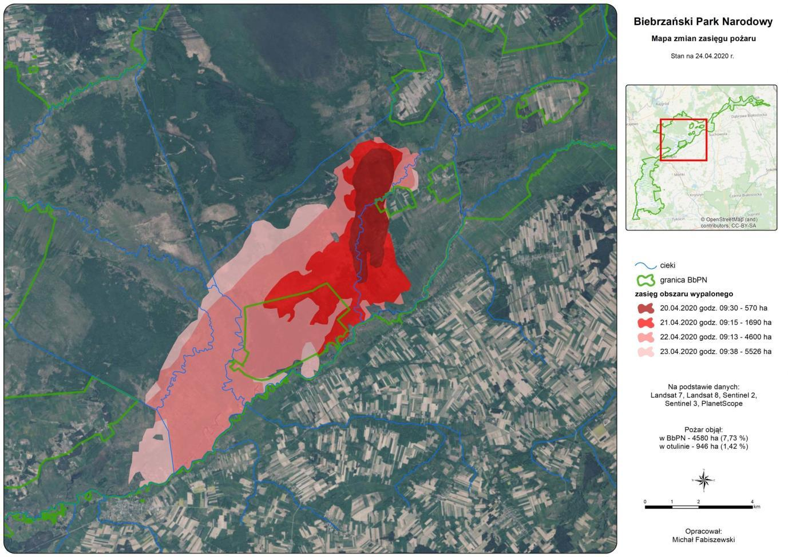

*Rys. 2. Mapa zmian zasięgu pożaru w BbPN w kwietniu 2020 r., stan na 24.04.2020, opracowanie M. Fabiszewski na podstawie zdjęć Landsat 7/8, Sentinel-2/3, PlanetScope (źródło: Wiatr 2021; za: Ceranka i in. 2025, Ryc. 2).*

Na podstawie mapy z Rys. 2:

| Data i godzina | Obszar wypalony | Przyrost | Kierunek rozwoju pożaru |
|---|---:|---:|---|
| 20.04, 09:30 | 570 ha | — | wąski pas N–S wzdłuż Biebrzy, na S od miejsca zapłonu |
| 21.04, 09:15 | 1690 ha | +1120 ha | na SW i W (w stronę Wrocenia) |
| 22.04, 09:13 | 4600 ha | +2910 ha | gwałtownie na SW, aż do okolic Goniądza (największy przyrost) |
| 23.04, 09:38 | 5526 ha | +926 ha | poszerzenie na NW (północna flanka, skraj lasów) |

Kształt pożarzyska jest wydłużony z NE na SW (ok. 15 km długości i 3–5 km szerokości). Od SE ogranicza go koryto Biebrzy, za którym leżą pola uprawne, od NW — skraj lasów (bronionych przez straż). Z kształtu i kolejności przyrostów wynika, że przez większość czasu ogień był pchany wiatrem z sektora **N–NE**, a pod koniec (22–23.04) rozwijał się na **N/NW**.

Dokładnych danych meteorologicznych (kierunek i prędkość wiatru godzina po godzinie) nie udało się znaleźć w dostępnych źródłach, dlatego funkcja wiatru w modelu (rozdział 5.4) jest **rekonstrukcją z obserwowanego przebiegu pożaru**, a nie pomiarem.

---

## 5. Odwzorowanie pożaru w modelu — zmodyfikowane fragmenty `fire.*`

### 5.1. Skale przestrzeni i czasu

Parametry fizyczne modelu nie zostały zmienione (są takie jak w prezentacji). Ponieważ nie są one skalibrowane do biomasy Biebrzy, przyjęliśmy przeliczenie jednostek modelu na rzeczywistość:

- **przestrzeń:** domena $[0,100] \times [0,100]$ odpowiada obszarowi $15 \times 15$ km, czyli **1 jednostka = 150 m** (1 j.² = 2,25 ha); oś $x$ — na wschód, oś $y$ — na północ,
- **czas:** **1 s symulacji = 25 h** (`hours_per_s = 25`), chwila $t = 0$ odpowiada 19.04.2020 ok. 20:00. Skalę dobrano tak, aby tempo rozwoju pożaru w symulacji było zbliżone do rzeczywistego (zatrzymanie pożaru 22–23.04),
- **liczba kroków:** 6000 kroków po $\Delta t = 10^{-3}$ s, czyli 6 s = 150 h (do 26.04 ok. 02:00, a więc do ostatniego dnia akcji gaśniczej, zakończonej 26.04 po południu) — ustawione w `fire.cpp`.

```cpp
// fire.hpp
// Skale scenariusza "Pozar Biebrzanskiego Parku Narodowego, 19-26.04.2020":
// 1 jednostka domeny = 150 m (domena 100 x 100 = 15 km x 15 km, os y na polnoc),
// 1 s symulacji = hours_per_s godzin rzeczywistych, t = 0 <-> 19.04.2020 ok. godz. 20:00
double hours_per_s = 25.0;

// fire.cpp
// 6000 krokow: 6 s = 150 h przy hours_per_s = 25, tj. do 26.04 (koniec akcji gasniczej)
ads::timesteps_config steps{6000, 1e-3};
```

Do budowy mapy paliwa, stanu początkowego i wiatru dodano dwie pomocnicze funkcje gładkiego przejścia:

```cpp
// Gladkie przejscie 0 -> 1 dla t w [a, b] (dziala tez dla a > b)
inline double smoothstep(double a, double b, double t) {
    double h = std::clamp((t - a) / (b - a), 0.0, 1.0);
    return h * h * (3 - 2 * h);
}

inline double mix(double a, double b, double h) { return (1 - h) * a + h * b; }
```

Gładkie przejścia (zamiast skoków) są potrzebne, ponieważ funkcje są rzutowane na bazę B-spline — nieciągłości dawałyby oscylacje (efekt Gibbsa).

### 5.2. Mapa paliwa

Mapa paliwa `fuel_init` odwzorowuje teren Basenu Środkowego Biebrzy (porównaj Rys. 1 i 2):

| Obszar | Wartość paliwa | Uzasadnienie |
|---|---:|---|
| pas doliny NE–SW: trzcinowiska, turzycowiska, łąki | 1.0 | suche po wiosennej suszy 2020, główne paliwo pożaru |
| lasy — oddzielne płaty: duże kompleksy Czerwone Bagno z Grzędami i Brzeziny Kapickie (na NW) oraz 5 małych płatów brzeziny i olsu w dolinie | 0.4 | niewiele suchej biomasy w runie — palą się krótko i słabo |
| na NW od doliny: wilgotne łąki i bagna; na N: mokre olsy | 0.15 | poniżej progu 0.2 — nie palą się; oddzielają duże kompleksy leśne od doliny |
| koryto Biebrzy (wzdłuż prostej (13, 7)–(82, 65)) | ≈ 0 | woda — naturalna bariera |
| za rzeką (SE): pola uprawne i wsie, pola na E i przy Goniądzu (SW) | 0.1 | poniżej progu 0.2 — nie palą się |
| enklawa rolna (wyspa mineralna) w (76, 76) | 0.1 | pola i zabudowa wewnątrz parku |

Las nie jest ciągły: każdy płat to elipsa (funkcja `ellipse`), a obszar leśny to suma tych elips (funkcja `forest`). Duże kompleksy leśne są oddzielone od suchej doliny pasem wilgotnych łąk, więc ogień nie ma po czym do nich dojść — w rzeczywistości te lasy udało się obronić. Spalić mogą się natomiast małe płaty lasu leżące wewnątrz doliny (łącznie ok. 870 ha), co odpowiada rzeczywistym 1127 ha spalonego lasu.

```cpp
// Odleglosc ze znakiem od koryta Biebrzy (prosta (13, 7) -> (82, 65)); > 0 na SE (pola uprawne)
static double river_dist(double x, double y) { return 0.644 * (x - 13) - 0.766 * (y - 7); }

// Odleglosc ze znakiem od skraju suchej czesci doliny (prosta (12, 24) -> (50, 82)); > 0 na NW
static double edge_dist(double x, double y) { return -0.836 * (x - 12) + 0.548 * (y - 24); }

// Plat lasu w ksztalcie elipsy o srodku (x0, y0) i polosiach a, b: 1 - las, 0 - brak lasu
static double ellipse(double x, double y, double x0, double y0, double a, double b) {
    double d = std::sqrt(std::pow((x - x0) / a, 2) + std::pow((y - y0) / b, 2));
    return 1 - smoothstep(0.8, 1.2, d);
}

// Lasy - oddzielne platy (las nie jest ciagly)
static double forest(double x, double y) {
    double f = std::max(ellipse(x, y, 36, 90, 18, 9),   // Czerwone Bagno i Grzedy
                        ellipse(x, y, 12, 58, 8, 12));  // Brzeziny Kapickie
    const double px[] = {20, 28, 40, 55, 62};           // male platy lasu (brzezina, ols) w dolinie
    const double py[] = {26, 38, 50, 65, 58};
    for (int i = 0; i < 5; ++i) {
        f = std::max(f, ellipse(x, y, px[i], py[i], 5, 5));
    }
    return f;
}

// Mapa paliwa (zakres 0..1, 1 - latwopalne, 0 - nie ma co sie palic)
double fuel_map(double x, double y) const {
    double f = 1.0;  // suche trzcinowiska, turzycowiska i laki (susza 2020)
    f = mix(f, 0.15, smoothstep(-2, 2, edge_dist(x, y)));    // NW: wilgotne laki i bagna - nie pala sie
    f = mix(f, 0.15, smoothstep(92, 96, y));                 // N: mokre olsy
    f = mix(f, 0.4, forest(x, y));                           // lasy - malo suchej biomasy w runie
    f = mix(f, 0.1, smoothstep(82, 86, x));                  // pola i enklawy na E
    f = mix(f, 0.1, smoothstep(22, 18, x + y));              // pola przy Goniadzu (SW)
    f = mix(f, 0.1, smoothstep(-1, 1, river_dist(x, y)));    // za rzeka: pola, wsie
    f *= 1 - std::exp(-std::pow(river_dist(x, y) / 1.2, 2));  // koryto Biebrzy - brak paliwa
    double ex = x - 76, ey = y - 76;
    f = mix(f, 0.1, 1 - smoothstep(3, 5, std::sqrt(ex * ex + ey * ey)));  // enklawa rolna
    return f;
}

// w before():
// Mapa paliwa
auto fuel_init = [this](double x, double y) { return fuel_map(x, y); };
```

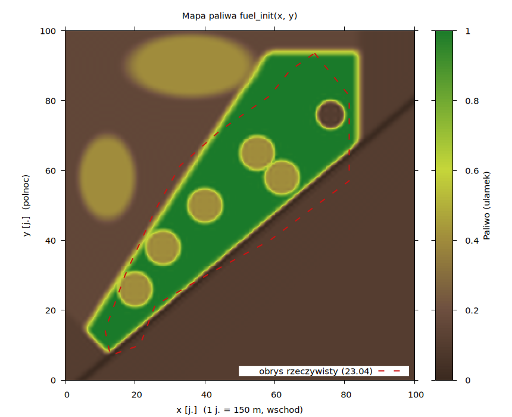

*Rys. 3. Mapa paliwa `fuel_init(x, y)` po rzutowaniu na bazę B-spline. Czerwona przerywana linia — przybliżony obrys rzeczywistego pożarzyska z 23.04.2020 (odczytany z Rys. 2, plik `kod/obrys_pozaru.dat`, 5490 ha).*

### 5.3. Stan początkowy

Stan początkowy to **dwa małe zarzewia** — miejsca wypalania traw — w obszarze, który spłonął najwcześniej (ciemnoczerwony pas "20.04, 570 ha" na Rys. 2, w północnej części pożarzyska, w rejonie Kopytkowa). Dokładne miejsce zapłonu nie jest podane w dostępnych źródłach — sposób jego wyznaczenia opisano w rozdziale 5.7 "Założenia i uproszczenia". Funkcja pomocnicza `bump` ma parametry środka zarzewia $(x_0, y_0)$.

```cpp
// Zarzewie o srodku (x0, y0)
inline double bump(double r, double R, double x, double y, double x0 = 50, double y0 = 50) {
    double dx = x - x0;
    double dy = y - y0;
    double t = std::sqrt(dx * dx + dy * dy) / 100;
    return falloff(r / 200, R / 200, t);
}

// Stan poczatkowy: dwa male zarzewia (wypalanie traw) w polnocnej czesci Basenu Srodkowego Biebrzy
double init_state(double x, double y) {
    double r = 2;   // pelna temperatura w promieniu 1 j. (150 m)
    double R = 16;  // brak podgrzania dalej niz 8 j. (1200 m), lagodne zbocze - stabilnosc
    double main_spot = bump(r, R, x, y, 72, 82);
    double second_spot = bump(r, 0.75 * R, x, y, 67, 73);
    return T0 + Tcomb * std::max(main_spot, second_spot);
}
```

- zarzewie główne w $(72, 82)$: $T = 1500$ K w promieniu 1 j. (150 m), łagodny spadek do $T_0 = 300$ K w promieniu 8 j. (1,2 km),
- zarzewie dodatkowe w $(67, 73)$: spadek do $T_0$ w promieniu 6 j. (900 m),
- obszar o temperaturze powyżej $T_{ig} = 800$ K: ok. 300 ha (zarzewie po kilku godzinach od podpalenia).

Zbocze zarzewi jest celowo łagodne: przy bardziej stromym (np. spadek w 5 j.) schemat jawny dawał silne niefizyczne "podcięcia" temperatury i rozbiegał się (rozdział 5.6).

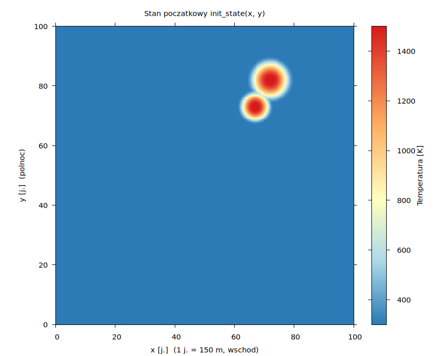

*Rys. 4. Stan początkowy temperatury `init_state(x, y)`.*

### 5.4. Funkcja wiatru $b_x(x,y,t)$, $b_y(x,y,t)$

Wiatr jest funkcją położenia i czasu. Kierunek i prędkość zależą od czasu rzeczywistego $h = t \cdot 25$ [h od 19.04 20:00] i odtwarzają kolejne fazy pożaru z tabeli w rozdziale 4.2; zależność od położenia to osłabienie wiatru nad płatami lasu (większa szorstkość terenu).

| Czas rzeczywisty | Krok symulacji | Kierunek wiatru (skąd → dokąd) | Prędkość $\lvert\mathbf b\rvert$ [j./s] | Efekt w pożarze |
|---|---|---|---:|---|
| 19.04 20:00 – 20.04 08:00 | 0 – 480 | z NNW → na S | 25 | ogień idzie na S wzdłuż rzeki |
| 20.04 08:00 – 20.04 20:00 | 480 – 960 | skręt z NNW na NE | 25 (od 16:00 rośnie) | front skręca na SW |
| 20.04 20:00 – 22.04 06:00 | 960 – 2320 | z NE → na SW | 40 (od 21.04 02:00), od 22.04 04:00 słabnie | główny bieg pożaru na SW (21–22.04) |
| 22.04 06:00 – 22.04 12:00 | 2320 – 2560 | skręt przez E (ogień na W) | 38 → 22 (słabnie do 22.04 14:00) | ogień dochodzi do okolic Goniądza |
| 22.04 12:00 – 22.04 22:00 | 2560 – 2960 | dalszy skręt, do wiatru z S (ogień na N) | 22 → 20 | front już tylko przy SW krańcu; flanka NW się nie poszerza* |
| 22.04 22:00 – 23.04 04:00 | 2960 – 3200 | z S | 20 | front przy SW krańcu słabnie i gaśnie |
| 23.04 04:00 – 23.04 14:00 | 3200 – 3600 | z S, słabnący | 20 → 5 | pożar wygasa |

\* Skręt wiatru na S miał odtworzyć poszerzenie pożarzyska na NW z 22–23.04 (Rys. 2). W symulacji w tym czasie pali się już tylko front przy SW krańcu doliny, a flanki NW nie poszerza, bo w mapie paliwa ogranicza ją prosty skraj suchej części doliny (rozdział 7.3). Skręt wiatru zatrzymuje natomiast bieg pożaru na SW.

```cpp
// Kierunek wiatru (kat wektora predkosci w stopniach, 0 = na wschod, 90 = na polnoc)
// i jego predkosc w zaleznosci od czasu rzeczywistego h [godz. od 19.04 20:00]
double wind_angle(double h) const {
    double a = -80;                                // wiatr z NNW -> ogien idzie na S wzdluz rzeki (20.04)
    a = mix(a, -135, smoothstep(12, 24, h));       // wiatr z NE  -> ogien idzie na SW (21-22.04)
    a = mix(a, -180, smoothstep(58, 64, h));       // 22.04 rano: wiatr z E -> ogien na W
    a = mix(a, -270, smoothstep(64, 74, h));       // 22-23.04: wiatr z S -> ogien skreca na N
    return a;
}

double wind_speed(double h) const {
    double w = 25;
    w = mix(w, 40, smoothstep(20, 30, h));   // silny wiatr 21-22.04
    w = mix(w, 20, smoothstep(56, 66, h));   // oslabienie 22.04
    w = mix(w, 5, smoothstep(80, 90, h));    // 23.04 - prawie cisza, pozar opanowany
    return w;
}

// Wiatr bx(x, y, t), by(x, y, t); nad lasem wiatr jest slabszy
double wind_factor(double x, double y) const { return 1 - 0.4 * forest(x, y); }

double bx(double x, double y, double t) const {
    double h = t * hours_per_s;
    return wind_factor(x, y) * wind_speed(h) * std::cos(wind_angle(h) * M_PI / 180);
}

double by(double x, double y, double t) const {
    double h = t * hours_per_s;
    return wind_factor(x, y) * wind_speed(h) * std::sin(wind_angle(h) * M_PI / 180);
}
```

Prędkość wiatru podana jest w jednostkach modelu (j./s), a nie w m/s — w modelu liczy się jej stosunek do własnej prędkości frontu ognia (ok. 15 j./s bez wiatru). Prędkość adwekcji ciepła to $c_W |\mathbf b| / c_p = 12{,}5$–$20$ j./s, czyli tyle, co prędkość frontu: ogień po zawietrznej przyspiesza mniej więcej dwukrotnie, a pod wiatr prawie się nie rozwija.

Klatki pola wiatru (tło: mapa paliwa, strzałki: wektor $\mathbf b$, krótsze nad lasem):

| Krok 0 (19.04 20:00) | Krok 1500 (21.04 09:30) |
|:---:|:---:|
| 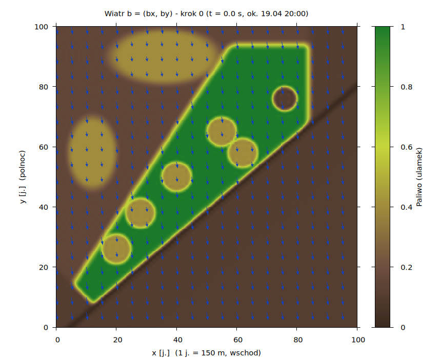 |  |

| Krok 2500 (22.04 10:30) | Krok 3000 (22.04 23:00) |
|:---:|:---:|
|  | 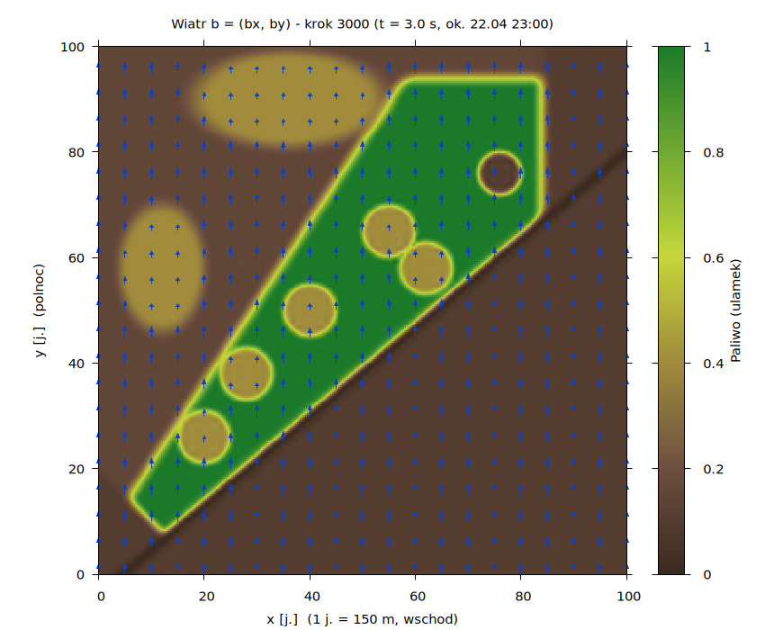 |

| Krok 3400 (23.04 09:00) | Krok 4000 (24.04 00:00) |
|:---:|:---:|
|  | 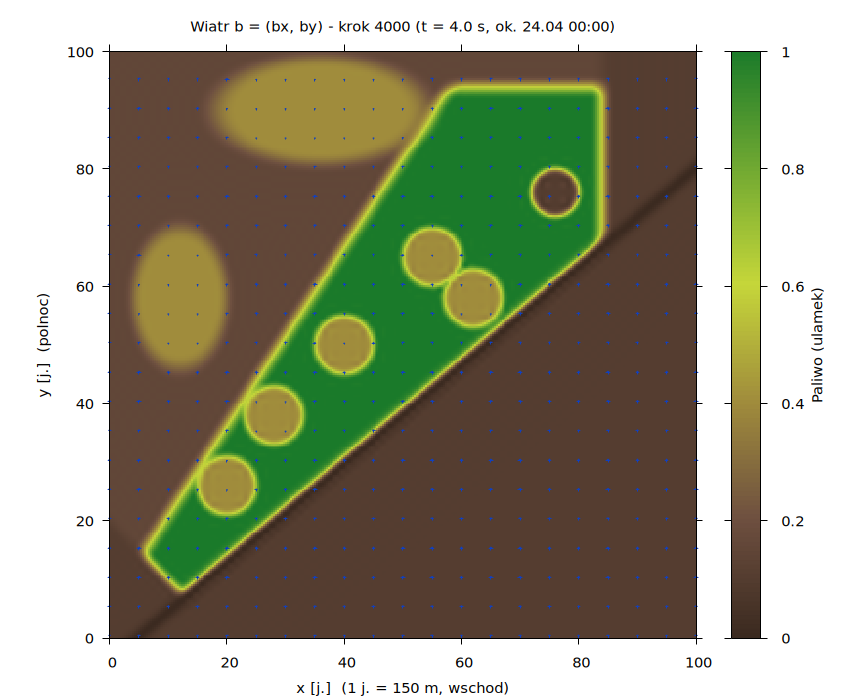 |

#### Animacja pola wiatru

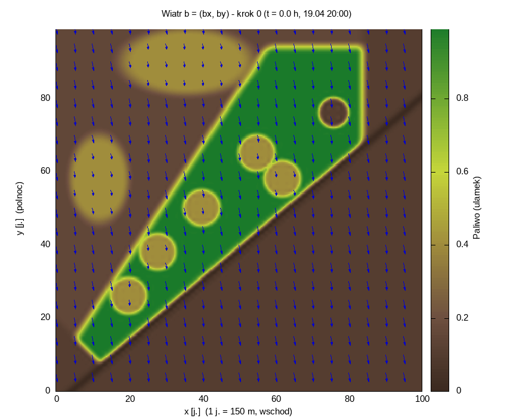

### 5.5. Zapis wyników

- pliki `out_*.data` i `fuel_*.data` zapisywane są **co 100 kroków** (≙ 2,5 h; każdy plik to 301 × 301 punktów, ok. 8,5 MB),
- dodatkowo zapisywane jest pole wiatru `wind_*.data` (siatka 21 × 21 punktów, kolumny `x y bx by`), z którego gnuplot rysuje strzałki.

```cpp
void after_step(int iter, double t) override {
    auto i = iter  +1;
    // Zapis wynikow co 100 krokow + zapis pola wiatru
    if (i % 100 == 0) {
        std::cout << "Step " << i << std::endl;
        output.to_file(u, "out_%d.data", i);
        output.to_file(fuel, "fuel_%d.data", i);
        save_wind(i, t + steps.dt);
    }
}

// Zapis pola wiatru na siatce 21 x 21 punktow: "x y bx by" (do gnuplota: with vectors)
void save_wind(int i, double t) const {
    char name[64];
    std::snprintf(name, sizeof(name), "wind_%d.data", i);
    std::ofstream os{name};
    for (int ix = 0; ix <= 20; ++ix) {
        for (int iy = 0; iy <= 20; ++iy) {
            double x = 5.0 * ix;
            double y = 5.0 * iy;
            os << x << ' ' << y << ' ' << bx(x, y, t) << ' ' << by(x, y, t) << '\n';
        }
        os << '\n';
    }
}
```

### 5.6. Uwagi numeryczne — warunek brzegowy i zabezpieczenie temperatury

Przy silnym wietrze ($|\mathbf b| \gtrsim 15$) sam schemat jawny z wyjściowego kodu `fire` rozbiega się: po ok. 100 krokach rozwiązanie zawiera same `NaN`. Analiza pokazała dwie przyczyny:

1. **Brzeg napływowy.** Człon adwekcji $-\mathbf b \cdot \nabla T$ jest dyskretyzowany metodą Galerkina bez stabilizacji, a przy dużej komórkowej liczbie Pécleta ($c_W |\mathbf b| h / D \approx 50$) przed frontem ognia powstają oscylacje, które wędrują pod wiatr. Na brzegu, przez który wiatr "wpływa" do domeny, naturalny warunek brzegowy (zerowy strumień) nie wygasza ich i oscylacje rosną bez ograniczeń. Rozwiązanie: **warunek Dirichleta $T = T_0$ na brzegu domeny** (daleko od pożaru panuje temperatura otoczenia), realizowany przez ustawienie brzegowych współczynników B-spline po każdym kroku:

   ```cpp
   void step(int /*iter*/, double t) override {
       compute_rhs(t);
       solve(u);
       solve(fuel);
       apply_bc(u);
   }

   // Warunek brzegowy T = T0 na brzegu domeny (daleko od pozaru - temperatura otoczenia).
   // Bez niego wiatr "wpadajacy" do domeny przez brzeg powoduje niestabilnosc schematu jawnego.
   void apply_bc(vector_type& T) const {
       int nx = x.dofs();
       int ny = y.dofs();
       for (int i = 0; i < nx; ++i) {
           T(i, 0) = T0;
           T(i, ny - 1) = T0;
       }
       for (int j = 0; j < ny; ++j) {
           T(0, j) = T0;
           T(nx - 1, j) = T0;
       }
   }
   ```

2. **Ujemna temperatura w członach nieliniowych.** Oscylacje mogą chwilowo dać $T < 0$ K. Wtedy człon $Q_{rz} \sim (T_0^4 - T^4)$ jeszcze bardziej obniża temperaturę, współczynnik $T^3$ w $q_r$ robi się ujemny (antydyfuzja), a $\exp(-T_a/T)$ przepełnia się — rozwiązanie "ucieka" do $-\infty$. Rozwiązanie: w członach $r$, $q_r$, $Q_{rz}$ używamy $T = \max(u, 1\,\mathrm{K})$ (fragment w rozdziale 3.3).

Zmniejszenie kroku czasowego (sprawdziliśmy $\Delta t = 2{,}5 \cdot 10^{-4}$) **nie** usuwało problemu, co potwierdza, że przyczyną był brzeg i nieliniowość, a nie warunek CFL. Pozostają chwilowe niefizyczne "podcięcia" temperatury przed frontem (widoczne jako delikatne prążki na klatkach temperatury). Występują one także w symulacji bez wiatru (minimum ok. 100 K), są ograniczone i nie wpływają na przebieg spalania.

### 5.7. Założenia i uproszczenia

1. **Skąd pochodzi mapa terenu.** Nie korzystaliśmy z danych GIS. Mapę paliwa zbudowaliśmy ręcznie na podstawie dwóch map z literatury: mapy parku (Rys. 1 — położenie koryta Biebrzy, lasów Czerwonego Bagna, Grzęd i Brzezin Kapickich, wsi i pól) oraz mapy zmian zasięgu pożaru (Rys. 2 — skala 4 km, układ rzeki, lasów i pól wokół pożarzyska). Rys. 2 przeskalowaliśmy do domeny (1 j. = 150 m) i odczytaliśmy z niego obrys pożarzyska (`kod/obrys_pozaru.dat`, 5490 ha wobec 5526 ha podanych na mapie). Granice obszarów (rzeka, skraj lasów) przybliżyliśmy liniami prostymi.
2. **Las jako oddzielne płaty.** Lasy przybliżyliśmy kilkoma elipsami o jednakowej ilości paliwa (0.4): dwa duże kompleksy po NW (Czerwone Bagno z Grzędami, Brzeziny Kapickie) i pięć małych płatów brzeziny i olsu w dolinie. Kształty i położenie płatów są orientacyjne (na podstawie Rys. 1), a nie dokładnym odwzorowaniem granic lasów. Pas doliny jest poza płatami jednorodny (1.0), choć w rzeczywistości są w nim fragmenty wilgotne, które się nie paliły.
3. **Miejsce zapłonu.** Źródła podają tylko, że ogień zauważono 19.04 w Basenie Środkowym. Media wymieniają w pierwszych dniach akcję gaśniczą m.in. w okolicach Kopytkowa i Polkowa (Forsal, 21–22.04). Dokładnej lokalizacji zapłonu nie znaleźliśmy. Zarzewia umieściliśmy więc w obszarze, który według Rys. 2 spłonął jako pierwszy (pas "20.04, 570 ha" w północnej części pożarzyska, w rejonie Kopytkowa). Dwa zarzewia zamiast jednego odpowiadają informacji, że ogień od początku rozprzestrzeniał się w kilku kierunkach (Copernicus EMS).
4. **Brak akcji gaśniczej.** Model nie zawiera gaszenia — pożar pali się samoczynnie, aż zabraknie paliwa albo zatrzyma go bariera (rzeka, pola) lub zmiana wiatru. Wpływ gaszenia (ok. 1500 strażaków, zrzuty wody, obrona lasów) jest w modelu obecny co najwyżej pośrednio: przez małą ilość paliwa w lasach oraz dobór skali czasu do rzeczywistego momentu zatrzymania pożaru. Jest to jedna z przyczyn rozbieżności omówionych w rozdziale 7.3.
5. **Wiatr.** Kierunek i prędkość wiatru zrekonstruowaliśmy z przebiegu pożaru (rozdział 4.2) i relacji prasowych, a nie z pomiarów meteorologicznych.
6. **Skale.** Parametry fizyczne modelu pozostały takie jak w prezentacji. Przeliczenie 1 j. = 150 m i 1 s = 25 h jest umowne.

---

## 6. Symulacja i wyniki

### 6.1. Parametry uruchomieniowe

- siatka B-spline: stopień $p = 2$, $N = 100$ elementów w każdym kierunku (1 element = 150 m),
- liczba wątków Galois: 8,
- krok czasowy $\Delta t = 10^{-3}$ s, 6000 kroków ($T = 6$ s ≙ 150 h),
- zapis co 100 kroków (≙ 2,5 h): `out_*.data`, `fuel_*.data`, `wind_*.data`,
- czas obliczeń: ok. 4–5 min (8 wątków, kontener Docker).

Uruchomienie (repozytorium iga-ads, gałąź `develop`, kontener według instrukcji `spciaa-instrukcja.pdf`, wymaga Dockera i `just`; w tej wersji repozytorium kontener uruchamia `just start`, a programy trafiają do `/build/bin`):

```bash
just image            # budowa obrazu (jednorazowo)
just start            # uruchomienie kontenera i powłoki
cont> just config
cont> cmake --build /build --target fire      # lub: just build
cont> mkdir -p /code/examples/fire/wyniki && cd /code/examples/fire/wyniki
cont> /build/bin/fire 100 2 8
```

Wykresy, animacje i tabela powierzchni wypalonej (`gnuplot`, `python3-numpy` doinstalowane w kontenerze przez `apt-get install gnuplot-nox python3-numpy`):

```bash
cont> python3 /code/examples/fire/burned_area.py > area.dat
cont> gnuplot /code/examples/fire/plot.gp
```

### 6.2. Wybrane kroki czasowe — rozkład temperatury

| Krok 0 (19.04 20:00) | Krok 500 (20.04 08:30) |
|:---:|:---:|
| 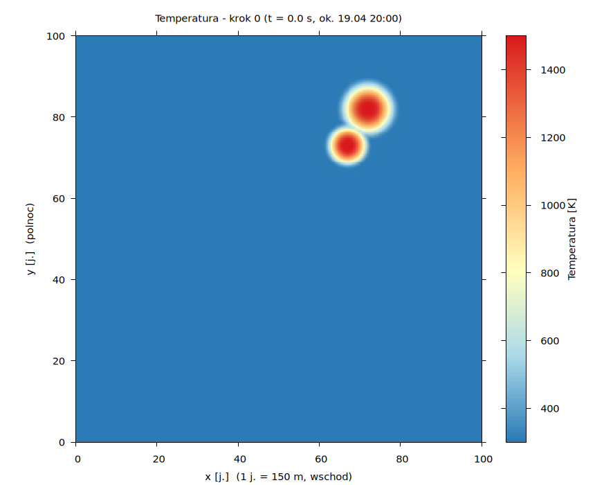 | 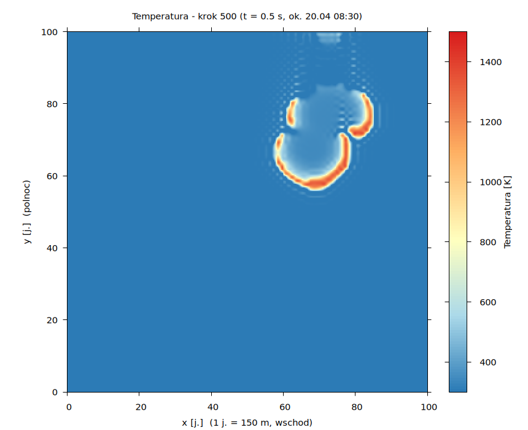 |

| Krok 1000 (20.04 21:00) | Krok 1500 (21.04 09:30) |
|:---:|:---:|
| 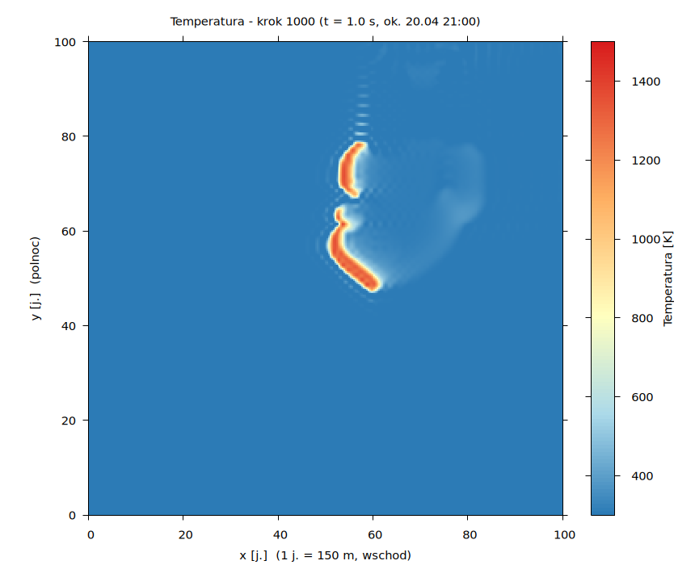 | 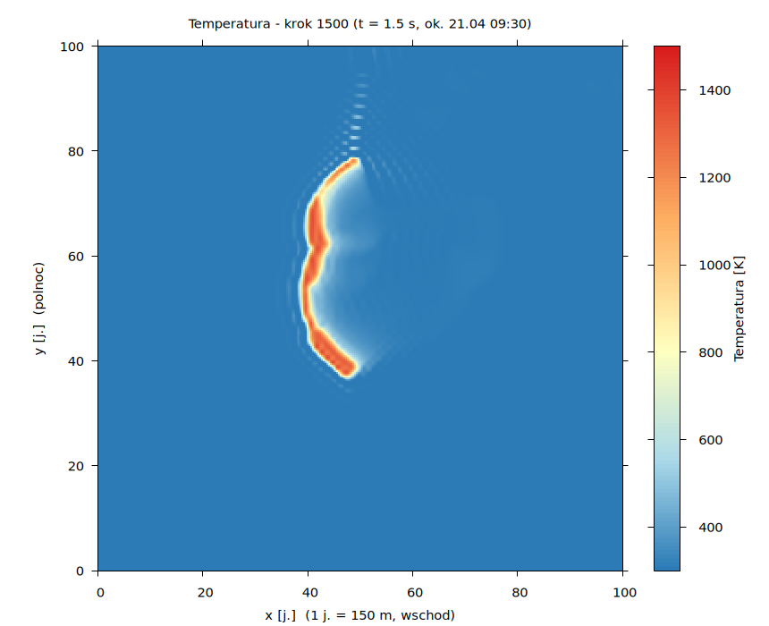 |

| Krok 2000 (21.04 22:00) | Krok 2500 (22.04 10:30) |
|:---:|:---:|
| 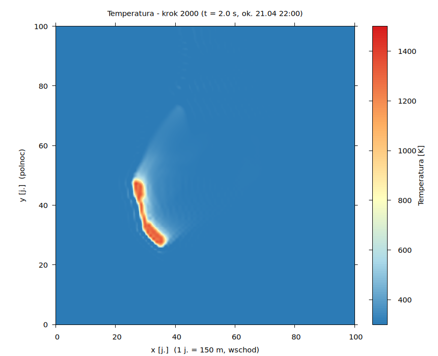 | 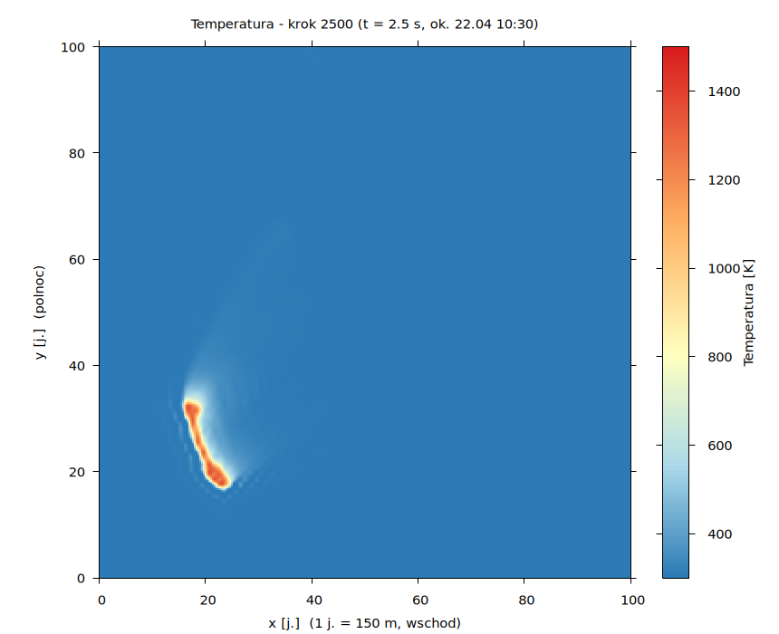 |

| Krok 3000 (22.04 23:00) | Krok 3400 (23.04 09:00) |
|:---:|:---:|
| 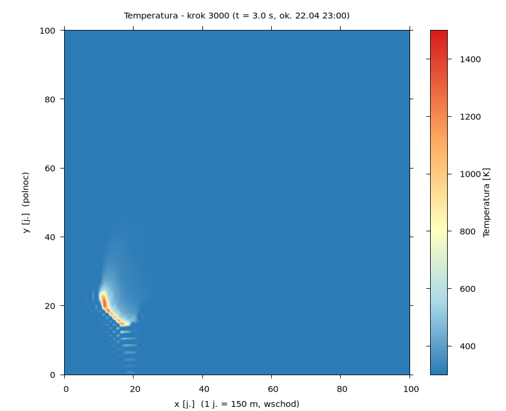 | 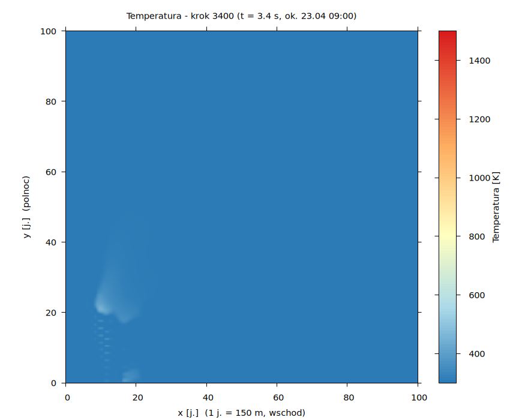 |

### 6.3. Wybrane kroki czasowe — rozkład paliwa

Czerwona przerywana linia — obrys rzeczywistego pożarzyska z 23.04.2020.

| Krok 500 (20.04 08:30) | Krok 1500 (21.04 09:30) |
|:---:|:---:|
| 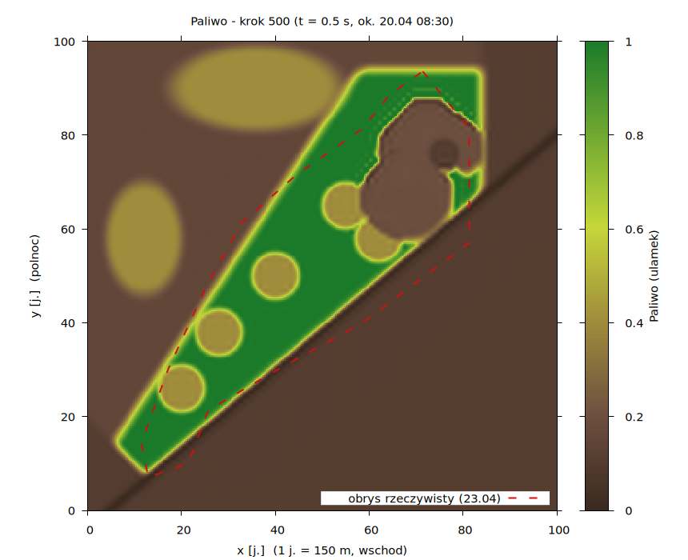 | 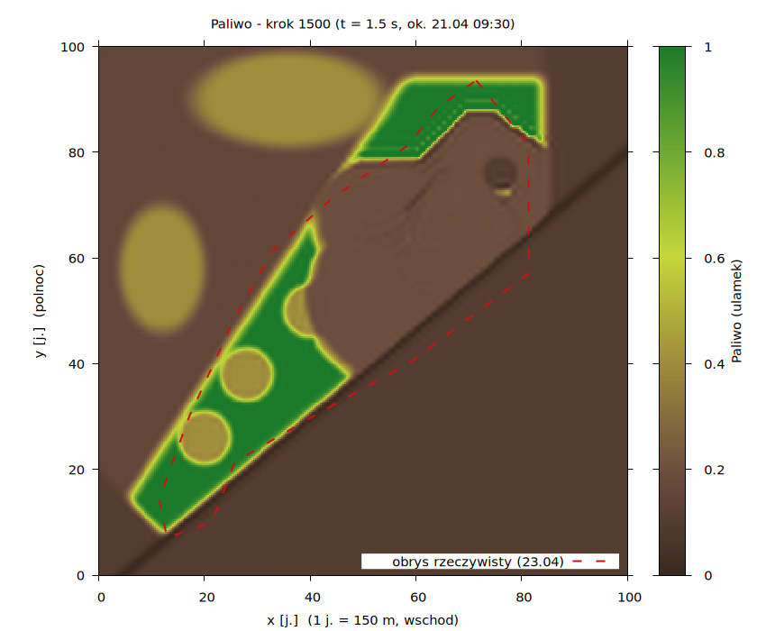 |

| Krok 2500 (22.04 10:30) | Krok 3400 (23.04 09:00) |
|:---:|:---:|
| 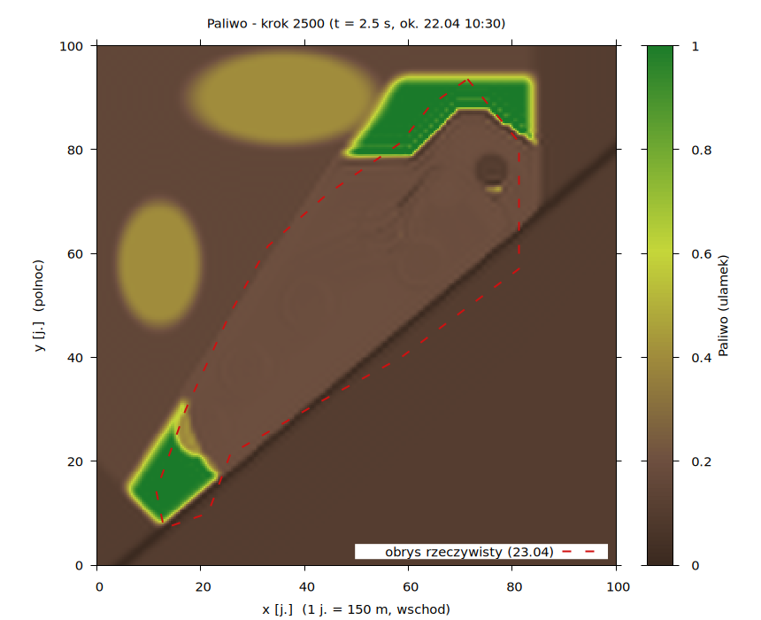 | 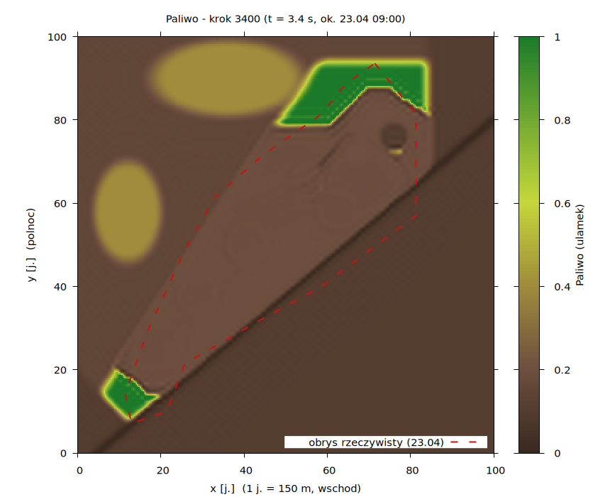 |

Pozostałe klatki (kroki 0–3000 co 500 oraz kroki 3400, 4000 i 6000) znajdują się w katalogu [`frames/`](frames/): `temp_*.png`, `fuel_*.png`, `wind_*.png`.

### 6.4. Animacje

#### Animacja pożaru (temperatura)

(W wersji PDF widoczna jest tylko pierwsza klatka animacji — pełne animacje: `anim.gif`, `fuel_anim.gif`, `wind_anim.gif`.)

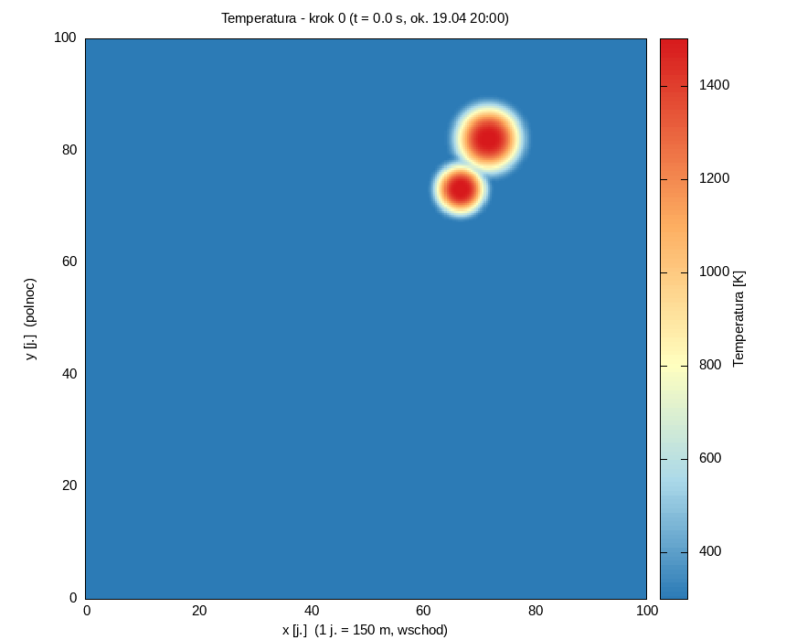

#### Animacja wypalania paliwa

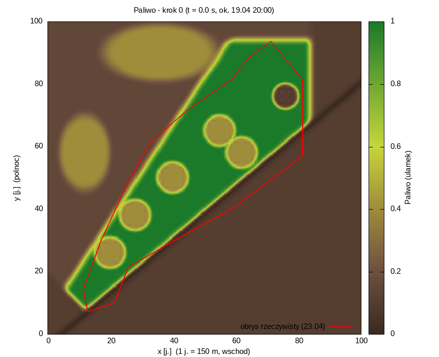

#### Animacja pola wiatru

Zob. rozdział 5.4 "Funkcja wiatru" (`wind_anim.gif`).

---

## 7. Porównanie symulacji z przebiegiem pożaru w BbPN

### 7.1. Powierzchnia wypalona w czasie

Punkt uznajemy za wypalony, jeśli miał paliwo ($> 0.2$) i stracił co najmniej 40% paliwa (`kod/burned_area.py`, pełna tabela w `area.dat`). Za las uznajemy punkty leżące w płatach lasu, tzn. te, w których funkcja `forest(x, y)` z `fire.hpp` przekracza 0,5.

| Chwila (rzeczywista) | Krok symulacji | Pożar BbPN (mapa) | Symulacja | w tym las (symulacja) |
|---|---:|---:|---:|---:|
| 20.04, 09:30 (13,5 h) | 540 | 570 ha | ok. 1170 ha | ok. 80 ha |
| 21.04, 09:15 (37,3 h) | 1490 | 1690 ha | ok. 2920 ha | ok. 430 ha |
| 22.04, 09:13 (61,2 h) | 2450 | 4600 ha | ok. 4470 ha | ok. 780 ha |
| 23.04, 09:38 (85,6 h) | 3420 | **5526 ha** | **4817 ha** | 871 ha (rzecz. 1127 ha) |
| 26.04, 02:00 (150 h) | 6000 | 5526 ha | 4817 ha | 871 ha |

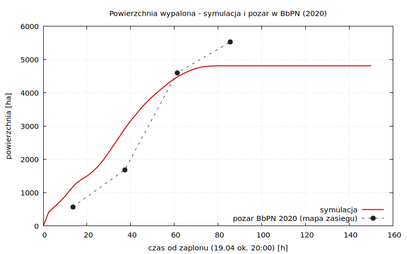

*Rys. 5. Powierzchnia wypalona w funkcji czasu: symulacja (linia ciągła) i pomiary z mapy BbPN (punkty).*

### 7.2. Kształt pożarzyska

Porównanie obszaru wypalonego w symulacji z obrysem rzeczywistym (23.04, Rys. 3 i klatka `fuel_03400.png`):

- część wspólna: 4442 ha,
- symulacja pokrywa **81%** rzeczywistego pożarzyska, a **92%** obszaru spalonego w symulacji leży wewnątrz rzeczywistego obrysu,
- współczynnik Jaccarda (IoU) = **0,76**.

### 7.3. Omówienie

**Zgodności:**

1. **Kierunek i kształt.** Pożar w symulacji, tak jak rzeczywisty, rozwija się z północnej części Basenu Środkowego na SW wzdłuż doliny i tworzy wydłużony (ok. 15 km × 4 km) obszar zorientowany NE–SW. Front biegnie zgodnie z wiatrem, a pod wiatr ogień praktycznie nie postępuje.
2. **Bariery.** Koryto Biebrzy i pola uprawne za nim całkowicie zatrzymują ogień od SE — w rzeczywistości od SE pożarzysko również ograniczała dolina rzeki i pola za nią (Rys. 2), choć jego granica nie jest tak prosta jak w modelu (patrz "Rozbieżności", pkt 2). Enklawa rolna jest omijana.
3. **Przebieg w czasie od 22.04.** 22.04 rano symulacja ma 4470 ha wobec rzeczywistych 4600 ha, a pożar zatrzymuje się 22/23.04 — tak jak w rzeczywistości obszar wypalony nie rośnie już po 23.04 (przy czym skala czasu była dobierana właśnie pod ten przebieg).
4. **Las.** Duże kompleksy leśne (Czerwone Bagno, Grzędy, Brzeziny Kapickie), oddzielone od doliny wilgotnymi łąkami, nie spłonęły — tak jak w rzeczywistości, gdzie zostały obronione. Spłonęły wszystkie małe płaty lasu w dolinie: 871 ha wobec rzeczywistych 1127 ha.

**Rozbieżności:**

1. **Za szybki początek.** W pierwszej dobie symulacja spala ok. 2 razy więcej niż rzeczywisty pożar (1170 vs 570 ha, 2920 vs 1690 ha). Model nie ma mechanizmów, które spowalniały ogień w rzeczywistości: nocnego spadku temperatury i wzrostu wilgotności, wilgotnych fragmentów torfowisk ani akcji gaśniczej (zrzuty wody, pasy przeciwpożarowe). Własna prędkość frontu w modelu jest stała i duża, dlatego przyrost powierzchni jest prawie liniowy, a rzeczywisty miał wyraźny skok 21–22.04.
2. **Mniejszy zasięg końcowy i kształt flanek.** Końcowa powierzchnia w symulacji jest o ok. 13% mniejsza (4817 ha wobec 5526 ha). Rozbieżności kształtu mają trzy różne przyczyny:
   - **Granice doliny jako linie proste.** W mapie paliwa koryto Biebrzy i skraj suchej części doliny są prostymi, a w rzeczywistości są nieregularne i przecięte kanałami. W części NE rzeczywiste pożarzysko sięga ok. 1 km dalej na SE niż modelowa rzeka — ok. 480 ha rzeczywistego obrysu leży w modelu na polach za rzeką. Po NW stronie prostego skraju doliny leży ok. 150 ha obrysu (wybrzuszenie z 22–23.04). Łącznie ok. 710 ha rzeczywistego pożarzyska (13% obrysu) ma w modelu paliwo $\le 0.2$, więc symulacja z tą mapą paliwa mogłaby pokryć co najwyżej ok. 87% obrysu.
   - **Dynamika wiatru.** Północny "cypel" przy Kopytkowie i SW kraniec przy Goniądzu mają w modelu pełne paliwo (1.0), ale nie spłonęły. Cypel leży pod wiatr od zarzewi (wiatr wieje z N–NE od początku symulacji), a do SW krańca front nie dociera przed skrętem i osłabnięciem wiatru 22.04.
3. **Wiatr jest rekonstrukcją.** Funkcja wiatru została dobrana na podstawie obserwowanego przebiegu pożaru i relacji prasowych, a nie pomiarów meteorologicznych. Zgodność kierunku rozwoju pożaru jest więc częściowo "wbudowana" w scenariusz. Wartością dodaną modelu jest pokazanie, że przy takim wietrze i takim rozkładzie paliwa ogień rzeczywiście układa się w wydłużony pas ograniczony rzeką.
4. **Skale nieskalibrowane.** Parametry fizyczne modelu nie są dopasowane do biomasy Biebrzy, a przeliczenie jednostek (1 j. = 150 m, 1 s = 25 h) jest umowne. Porównanie ma więc charakter jakościowy i półilościowy.

---

## 8. Wnioski i obserwacje fizyczne

1. **Struktura frontu pożaru:**
   Zarzewie powoduje gwałtowne wypalenie paliwa w swoim otoczeniu. Gdy poziom paliwa spada poniżej progu $\text{fuel} \le 0.2$, reakcja zostaje wstrzymana ($\delta = 0$), a temperatura za frontem spada w wyniku wymiany konwekcyjnej $Q_{conv}$ i radiacji $Q_{rz}$ ku niebu. W efekcie pożar ma postać wąskiego, gorącego frontu (ok. 1300–1400 K) przesuwającego się po paliwie i zostawiającego za sobą wypalony, stygnący obszar.

2. **Rozprzestrzenianie się:**
   Ciepło przenoszone przez przewodnictwo $q_C$ oraz nieliniowe promieniowanie poziome $q_r \sim T^3 \nabla T$ podgrzewa sąsiednie paliwo. Po przekroczeniu temperatury zapłonu $T_{ig} = 800\,\mathrm{K}$ następuje zapłon świeżego paliwa. Bez wiatru i przy jednorodnym paliwie daje to symetryczny pierścień rozszerzający się na zewnątrz.

3. **Wpływ wiatru (człon $Q_W$):**
   Przy wietrze o prędkości adwekcji porównywalnej z własną prędkością frontu pożar staje się silnie asymetryczny: po zawietrznej front przyspiesza, a pod wiatr zatrzymuje się. Zmiana kierunku wiatru (z NE na S) 22.04 zatrzymuje bieg pożaru na SW; dalszy przyrost jest już niewielki (ok. 370 ha), bo od NW pożar ograniczają wilgotne łąki.

4. **Wpływ mapy paliwa:**
   Rozkład paliwa decyduje o tym, gdzie pożar się zatrzyma. Obszary z paliwem $\le 0.2$ (rzeka, pola, wilgotne łąki) są absolutną barierą, a płaty lasu z małą ilością paliwa (0.4) palą się krótko i słabo. Nieciągłość lasu ma znaczenie: płaty leżące w suchej dolinie płoną razem z nią, a kompleksy odcięte pasem wilgotnych łąk pozostają nietknięte.

5. **Numeryka:**
   Schemat jawny z niestabilizowaną adwekcją Galerkina wymaga przy silnym wietrze warunku brzegowego $T = T_0$ i zabezpieczenia $T > 0$ w członach nieliniowych (rozdział 5.6). Naturalnym rozszerzeniem byłaby stabilizacja typu SUPG członu wiatru.

---

## 9. Zawartość katalogu

| Plik / katalog | Zawartość |
|---|---|
| `fire_report.md`, `fire_report.pdf` | niniejsze sprawozdanie (źródło Markdown i wersja PDF) |
| `kod/fire.hpp`, `kod/fire.cpp`, `kod/CMakeLists.txt` | zmodyfikowany kod symulacji (kopia z `iga-ads/examples/fire/`) |
| `kod/plot.gp` | skrypt gnuplota: klatki PNG i animacje GIF |
| `kod/burned_area.py` | powierzchnia wypalona w czasie i zgodność z obrysem rzeczywistym |
| `kod/obrys_pozaru.dat` | przybliżony obrys pożarzyska z 23.04.2020 w układzie domeny |
| `frames/` | klatki PNG: `temp_*`, `fuel_*`, `wind_*`, `fuel_map`, `init_state`, `area` |
| `anim.gif`, `fuel_anim.gif`, `wind_anim.gif` | animacje temperatury, paliwa i wiatru |
| `area.dat` | tabela powierzchni wypalonej (co 100 kroków) |
| `img/` | rysunki pożaru z literatury |

---

## Źródła

1. P. Grasso, M. S. Innocente, *Physics-based model of wildfire propagation towards faster-than-real-time simulations*, Computers & Mathematics with Applications 80(5) (2020) 790–808.
2. M. Łoś, M. Paszyński, *Wildfire IGA-ADS simulations*, prezentacja, AGH, 2024.
3. J. Ceranka, A. Radecka, K. Osińska-Skotak, *Badanie dynamiki odnawiania się siedlisk przyrodniczych w Biebrzańskim Parku Narodowym po pożarze z 2020 r.*, Teledetekcja Środowiska 65 (2025) 1–17, https://teledetekcja.pw.edu.pl/wp-content/uploads/2025/12/tds_Biebrza_JC_AR_KOS.pdf (dane o zasięgu 5526 ha, podział na las/nie-las, Rys. 1 i Rys. 2 — za: Wiatr 2021, opr. M. Fabiszewski, BbPN).
4. E. Wiatr (red.), *Kronika Biebrzańskiego Parku Narodowego 2020 r.*, Biebrzański Park Narodowy, Osowiec-Twierdza, 2021 (źródło Rys. 2 i danych o zasięgu; cytowane za: Ceranka i in. 2025).
5. Copernicus Emergency Management Service, aktywacja EMSR436 *Fire in Podlaskie Voivodeship — Poland*, https://mapping.emergency.copernicus.eu/activations/EMSR436/
6. Ministerstwo Klimatu i Środowiska, *Pożar w Biebrzańskim Parku Narodowym — podsumowanie i dalsze działania*, 28.04.2020, https://www.gov.pl/web/srodowisko/pozar-w-biebrzanskim-parku-narodowym---podsumowanie-i-dalsze-dzialania
7. RMF24, *Pożar w Biebrzańskim Parku Narodowym. Sytuacja się nie pogarsza*, 22.04.2020, https://www.rmf24.pl/fakty/polska/news-pozar-w-biebrzanskim-parku-narodowym-sytuacja-sie-nie-pogars,nId,4454497
8. Forsal.pl, *Biebrzański Park Narodowy: pożar*, 22.04.2020, https://forsal.pl/artykuly/1471080,biebrzanski-park-narodowy-pozar.html
9. Notes from Poland, *With week-long fire extinguished, Poland’s largest national park offers reward to find arsonists*, 27.04.2020, https://notesfrompoland.com/?p=11192
